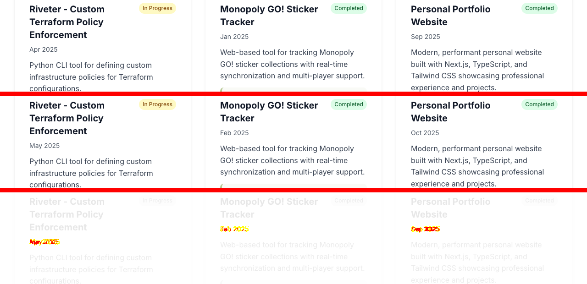

# Task 03 Proofs - Shared date helper, shared placeholder, style cleanup

## Task Summary

Four copies of date formatting are replaced by one helper, `src/lib/dates.ts`. Seven copies of the lazy-load placeholder are replaced by one component, `SectionPlaceholder`. The stray `dark:` classes, the unused magenta `accent` color scale and the last raw `` are removed. The shared helper also fixes a timezone bug: the old `PersonalProjectCard` code showed the previous month whenever the page was built west of UTC.

## What This Task Proves

- Date output comes from one helper and is the same in every timezone (Spec Unit 3, FR 1).
- One placeholder component, with no `dark:` classes, serves all 7 lazy sections (FR 2, FR 3).
- `PersonalProjectCard` renders SVGs through `OptimizedImage` / `next/image`, so there's no `` lint warning (FR 4).
- The `accent` color scale is gone (FR 5).
- The page matches the production (UTC-built) rendering pixel for pixel. The only difference from the local baseline is the three month labels the timezone bug used to shift.
- No regressions: 30 unit test files and 539 tests pass. E2E has the same 18 failures as the baseline. Bundle size is unchanged (`/` First Load JS 98.4 kB).

## Evidence Summary

| Check | Result |
| --- | --- |
| `dates.test.ts` | 11 / 11, including the same output in UTC, New York, Los Angeles and Tokyo |
| Existing Experience / Education tests | 50 / 50 with **no** expectation changes |
| Timezone-shifted expectations | exactly 3 failed before the fix (A2 + A6) and were corrected |
| `dark:` in source / `accent-` / old placeholder / local formatters | 0 / 0 / 0 / 0 |
| Lint on `PersonalProjectCard.tsx` | ✔ No ESLint warnings or errors |
| Pixel diff vs **UTC-built** 2.0 (production-equivalent) | **0 / 0 / 0** |
| Pixel diff vs local Eastern-time baseline | 643 px at each width: only the 3 corrected month labels |
| Unit suite | 30 files, 539 tests passed |
| E2E | 72 passed / 18 failed, same failure set as baseline |

## Findings During Implementation

- **A7, the timezone bug was visible in local builds.** The page is prerendered at build time. Built in US Eastern time, the old code showed the personal projects as `Apr 2025`, `Jan 2025`, `Sep 2025`, but the data says `2025-05`, `2025-02`, `2025-10`. The live site, built on Vercel in UTC, already shows `May/Feb/Oct 2025` (checked with `curl https://scottryanhoward.info`). The new helper produces those correct labels no matter where the build runs.
- **A8, stale build cache.** One incremental `next build` produced mismatched `next/font` class hashes between HTML and CSS, so the page fell back to system fonts. A clean rebuild (`rm -rf .next`) fixes it, and the problem can't be reproduced from a clean state with either import style. All proof builds now start clean.
- **`globals.css` dark-scheme variables (left as is):** captured with a dark OS color scheme, the page is pixel-identical to light mode, because every section paints its own background and no visible text uses the body color. Only the custom scrollbar colors would change. Noted as a follow-up.
- The `page.tsx` comment claimed `ssr: false` while the code uses `ssr: true`. It now describes what the code actually does.
- `src/test/performance.test.tsx` checked `page.tsx` for the literal `animate-pulse`. It now checks that **every** `dynamic()` section uses `<SectionPlaceholder />` (7 of 7), which is stricter than before.

## Artifact: Shared date helper

**What it proves:** one helper covers every format the four components used, without timezone drift.

**Why it matters:** the same logic was copied four times, and one copy had a real bug.

**Command:** `npx vitest run src/lib/dates.test.ts --reporter=verbose`

**Artifact path:** `01-proofs/3.0-dates-test.txt`

```
✓ formatMonthYear > formats YYYY-MM as short month and year
✓ formatMonthYear > returns Present unchanged
✓ formatDateRange > formats a closed range
✓ formatDateRange > formats an explicit Present end date
✓ formatDateRange > shows Present for a missing end date by default
✓ formatDateRange > shows only the start date for a missing end date when openEnded is omit
✓ formatDateRange > ignores openEnded when an end date is given
✓ timezone independence > formats the same month in UTC
✓ timezone independence > formats the same month in America/New_York
✓ timezone independence > formats the same month in America/Los_Angeles
✓ timezone independence > formats the same month in Asia/Tokyo
Tests  11 passed (11)
```

The timezone test really does catch the old code. Switching `TZ` at runtime in Node reproduces the bug:

```
UTC                old: Jan 2023 | new: Jan 2023
America/New_York   old: Dec 2022 | new: Jan 2023
Asia/Tokyo         old: Jan 2023 | new: Jan 2023
```

## Artifact: Only the timezone-shifted expectations changed

**What it proves:** switching components to the helper changed rendered dates only where the old output was wrong.

**Artifact path:** `01-proofs/3.0-timezone-expectations-before-fix.txt`

**Result summary:** with the helper in place and the tests untouched, exactly 3 assertions failed, all on the shifted months documented in A2 and A6. Experience and Education tests (50) passed with no changes. The corrected tests pass in both the local timezone and `TZ=UTC`. The old expectations would have failed on a UTC CI runner.

```
FAIL  PersonalProjects.test.tsx   > renders date ranges for projects                 (expected May 2022 - Dec 2022 for 2022-06..2023-01)
FAIL  PersonalProjectCard.test.tsx > renders date range when both start and end dates are provided (expected Dec 2022 - May 2023 for 2023-01..2023-06)
FAIL  PersonalProjectCard.test.tsx > renders only start date when end date is not provided         (expected Dec 2022 for 2023-01)
```

## Artifact: Duplicates and leftovers removed

**Artifact path:** `01-proofs/3.0-cleanup-greps.txt`

```
$ grep -rn "dark:" src --include="*.tsx" | grep -v "\.test\."          → no matches
$ grep -rn "accent-" src                                               → no matches
$ grep -c "min-h-\[400px\] animate-pulse" src/app/page.tsx             → 0
$ grep -rn "toLocaleDateString" src --include="*.tsx" | grep -v test   → no matches
$ grep -rn "const formatDate\|function formatDate" src --include="*.tsx" → no matches
$ npx next lint --file src/components/ui/PersonalProjectCard.tsx       → ✔ No ESLint warnings or errors
```

## Artifact: Visual comparison

**What it proves:** the refactor is invisible apart from the corrected month labels.

**Why it matters:** this task touched every dated section, the image pipeline and the Tailwind config.

**Commands:** clean build (`rm -rf .next && npm run build && npm run start`), then `shots.cjs` and `diff.cjs` (see `01-task-01-proofs.md`).

**Against the production-equivalent baseline** (2.0 code built and served with `TZ=UTC`, as on Vercel). Artifact path `01-proofs/3.0-pixel-diff-utc.txt`:

```
before-utc-375.png  vs after-3.0-375.png:  0 differing pixels (identical)
before-utc-768.png  vs after-3.0-768.png:  0 differing pixels (identical)
before-utc-1280.png vs after-3.0-1280.png: 0 differing pixels (identical)
```

**Against the local Eastern-time baseline.** Artifact path `01-proofs/3.0-pixel-diff.txt`:

```
before-375.png  vs after-3.0-375.png:  643 pixels are different
before-768.png  vs after-3.0-768.png:  643 pixels are different
before-1280.png vs after-3.0-1280.png: 643 pixels are different
```

The same 643 pixels at every width means a fixed-size change. The crop below shows the local Eastern-time baseline (top), 3.0 (middle) and the diff overlay (bottom). Only the three month labels differ: `Apr → May`, `Jan → Feb`, `Sep → Oct 2025`.

`01-proofs/3.0-date-label-diff-1280.png`



`01-proofs/after-3.0-375.png`


`01-proofs/after-3.0-768.png`


`01-proofs/after-3.0-1280.png`


## Artifact: Full suites

- `01-proofs/3.0-vitest.txt`: `Test Files 30 passed (30)`, `Tests 539 passed (539)`
- `01-proofs/3.0-e2e.txt`: 72 passed / 18 failed. A sorted diff of the failing tests against `1.0-e2e-baseline.txt` is empty.

## Reviewer Conclusion

Duplicated date and placeholder code is consolidated, and the leftover styles and raw `` are gone. The shared helper removes a timezone bug that made local builds show the wrong month. The page is pixel-identical to the production build, and every test result matches the baseline.
