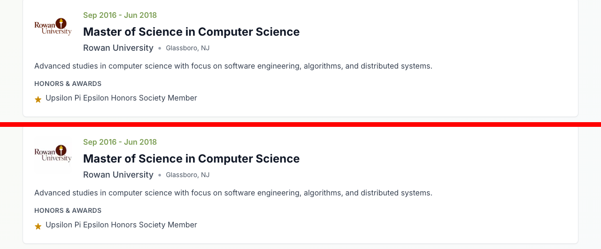

# Task 04 Proofs - Config leftovers and type safety

## Task Summary

This task brings every static check to a clean result. The deprecated `swcMinify` flag, the `react-icons` optimization for a package that isn't installed, and the placeholder Google verification tag are gone. `@next/bundle-analyzer` now matches Next's major version (14). The 26 TypeScript errors in tests are fixed without `@ts-ignore`. The last raw `` tags in production code are replaced.

## What This Task Proves

- `npx tsc --noEmit` exits 0 (was 26 errors) (Spec Unit 3, FR 9).
- `npm run lint` reports **No ESLint warnings or errors** (was 5 warnings).
- A clean `npm run build` succeeds with **0** warning lines (FR 6, FR 7, FR 8).
- The axe matcher is registered once, typed for Vitest, and still catches real violations.
- No visual change: 0 differing pixels compared with task 3.0 at all three widths. All tests match the baseline.

## Evidence Summary

| Check | Before | After |
| --- | --- | --- |
| `tsc --noEmit` | 26 errors (3 test files) | exit 0, no output |
| `npm run lint` | 5 `no-img-element` warnings | ✔ No ESLint warnings or errors |
| `npm run build` warnings | lint warnings in build output | 0 warning lines |
| `swcMinify` / `react-icons` in `next.config.js` | present | absent |
| Google verification placeholder | present | absent (also not in built HTML) |
| `@next/bundle-analyzer` | 15.5.5 | 14.2.35 (next 14.2.33) |
| Axe negative check | n/a | fails on `` without `alt` (`image-alt`) |
| Unit suite | 539 passed | 539 passed |
| Pixel diff vs 3.0 | n/a | 0 / 0 / 0 |
| E2E | 72 / 18 | 72 / 18, same failure set |

## Decisions Made During Implementation

- **A9, two more raw `` tags:** besides `PersonalProjectCard` (fixed in 3.0), `Education.tsx` and `Volunteering.tsx` rendered logos with raw ``. They now use `OptimizedImage` with `unoptimized` and `placeholder="empty"`. The first attempt ran them through the local image optimizer, which changed logo pixels. Locally `next start` has no `sharp`, and the BSides logo picked up a green (`0,255,0`) corner where the original reads `0,0,0`. Serving the original files keeps the page identical to before. The three `` tags inside `next/image` **test mocks** keep a scoped `eslint-disable-next-line`.
- **A10, axe types without `@types/jest-axe`:** that package depends on `@types/jest`, whose globals clash with Vitest's, and on `axe-core@^3.5.5`. Two small declaration files replace it instead.
- **Tests aligned with the spec:** `performance.test.tsx` asserted `swcMinify: true`, the opposite of the spec. It now asserts the deprecated keys are absent. `seo.test.tsx` read union-typed metadata inside `if` guards, so it would pass silently if the metadata changed shape. It now uses `toEqual`/`toMatchObject`, which fixes the 7 type errors and makes the checks stricter.
- **Bundle analyzer:** `npm run analyze` wasn't run, because it opens browser tabs. Loading the config with `ANALYZE=true` confirms the v14 plugin loads and wraps webpack.

## Artifact: Type check is clean

**What it proves:** test code type-checks without suppressions.

**Command:** `npx tsc --noEmit; echo "exit=$?"`

**Artifact path:** `01-proofs/4.0-tsc.txt`

```
exit=0
```

How the 26 errors were resolved:

| File | Errors | Fix |
| --- | --- | --- |
| `src/test/accessibility.test.tsx` | 14 | `jest-axe.d.ts` (module types) + `vitest-axe.d.ts` (matcher on Vitest's `Assertion`) |
| `src/test/status-badge-visual-regression.test.tsx` | 5 | same |
| `src/app/seo.test.tsx` | 7 | whole-object `toEqual`/`toMatchObject` instead of property access on union types |

## Artifact: Lint is clean

**Command:** `npm run lint`

**Artifact path:** `01-proofs/4.0-lint.txt`

```
> personal-website@0.1.0 lint
> next lint

✔ No ESLint warnings or errors
```

## Artifact: Clean production build

**What it proves:** the config loads without deprecated keys, and the build passes lint and type checks.

**Command:** `rm -rf .next && npm run build`

**Artifact path:** `01-proofs/4.0-build.txt`

**Result summary:** `grep -ciE 'warn|swcMinify|invalid next.config|unrecognized key'` on the log returns `0`. The page size is unchanged from the 1.0 baseline (`/` 11.2 kB, First Load JS 98.4 kB). The baseline build (`1.0-build-baseline.txt`) had 6 warning lines.

```
✓ Compiled successfully
  Linting and checking validity of types ...
┌ ○ /                                    11.2 kB        98.4 kB
```

## Artifact: Leftovers removed

**Artifact path:** `01-proofs/4.0-leftover-greps.txt`

```
$ grep -n "swcMinify\|react-icons" next.config.js              → (no matches)
$ grep -n "google-site-verification-code" src/app/layout.tsx  → (no matches)
$ npm ls @next/bundle-analyzer next
├── @next/bundle-analyzer@14.2.35
└── next@14.2.33
$ grep -rn " */}   ← comment text only
```

## Artifact: Axe matcher still catches violations

**What it proves:** moving the matcher registration to `setup.ts` and adding types didn't weaken the accessibility tests.

**Command:** a temporary test rendering `<main></main>` and asserting `toHaveNoViolations()`. It was deleted after the run.

**Artifact path:** `01-proofs/4.0-axe-negative.txt`

```
FAIL  src/test/axe-negative.tmp.test.tsx > flags an image without alt text
"Images must have alternative text (image-alt)"
Tests  1 failed (1)
```

The real axe suites (`accessibility.test.tsx`, `status-badge-visual-regression.test.tsx`) pass: 51 / 51.

## Artifact: No visual change

**Command:** clean build, then `shots.cjs` and `diff.cjs` comparing against the 3.0 screenshots

**Artifact path:** `01-proofs/4.0-pixel-diff.txt`

```
after-3.0-375.png  vs after-4.0-375.png:  0 differing pixels (identical)
after-3.0-768.png  vs after-4.0-768.png:  0 differing pixels (identical)
after-3.0-1280.png vs after-4.0-1280.png: 0 differing pixels (identical)
```

The rejected optimized-logo attempt (kept for reference): every differing pixel was inside the 4 logo boxes and 0 were outside (`01-proofs/4.0-pixel-diff-locality.txt`). This crop shows the faint box it introduced. Top is 3.0, bottom is the optimized attempt:

`01-proofs/4.0-logo-compare-1280.png`



`01-proofs/after-4.0-1280.png`


## Artifact: Full suites

- `01-proofs/4.0-vitest.txt`: `Test Files 30 passed (30)`, `Tests 539 passed (539)`
- `01-proofs/4.0-e2e.txt`: 72 passed / 18 failed. A sorted diff of the failing tests against `1.0-e2e-baseline.txt` is empty.

## Reviewer Conclusion

Type checking, linting and the production build all pass with no warnings. The config leftovers and the placeholder are gone, and the accessibility matcher is typed and still catches violations. The page is pixel-identical to the previous task, and every test result matches the baseline.
